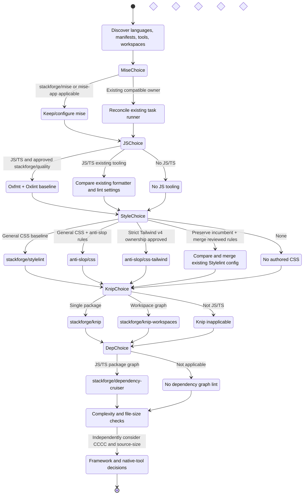
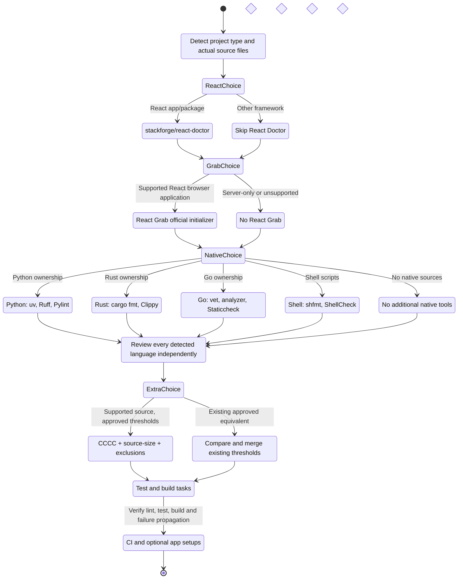
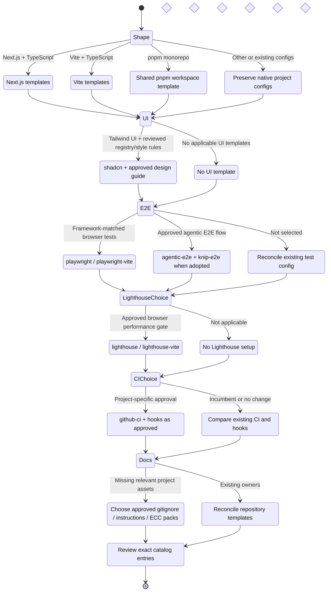
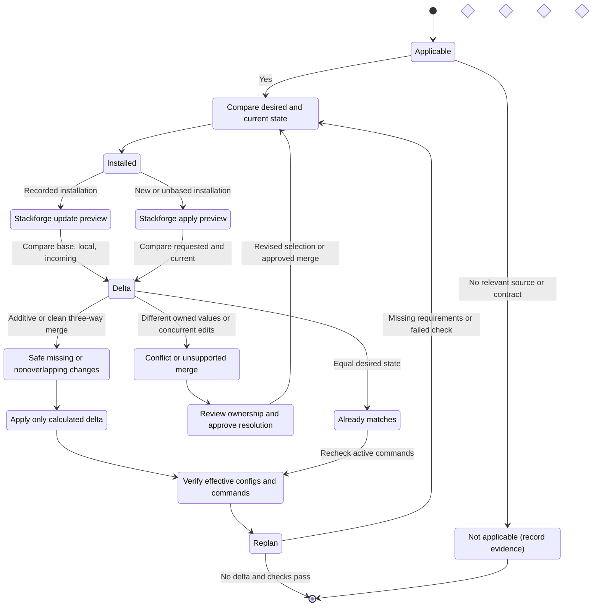

# Project setup selection: all valid options

This variant covers the **entire registered project setup stack**, not just anti-slop. The two source catalogs are `stackforge/stackforge.setups.toml` (the registered `stackforge` source) and [`anti-slop/stackforge.setups.toml`](../stackforge.setups.toml). PPM engineering also owns native setup decisions that do not have a Stackforge preset. The manifests and owning install guides remain authoritative. A selected option is **reconcile existing**, **install missing**, or **not applicable**. Existing files always undergo a semantic comparison against required settings before reaching **up to date**.

## 1. Core quality tooling decisions

Each check is evaluated independently for every applicable workspace. Where alternatives share configuration ownership, select **one owning configuration** and merge required rules after compatibility review. A plus sign in a state means the tool can join the other checks, not that it runs unconditionally.

**Separate ownership:** `stackforge/quality` provides baseline Oxfmt and Oxlint config; it must not install a second competing Oxlint config over `anti-slop/cloudflare`, `anti-slop/typescript`, or `anti-slop/effect`. The detailed [anti-slop decisions](#3-specialized-anti-slop-decisions) select the single JS/TS lint owner and optional rules. `stackforge/stylelint` provides the standard Stylelint config; `anti-slop/css` and `anti-slop/css-tailwind` offer specialized CSS policy. Their rules may be merged, but independent overlapping Stylelint configs must not both own the same files.

## 2. Framework, native language, and verification decisions

A mixed-language workspace may take **several** native branches, even though the chart draws one branch at a time. `React Grab` is a **development-time inspection tool**, not a CI lint gate. `Ruff`, `gofmt`, `go vet`, `cargo fmt`, `Clippy`, `Staticcheck`, `govulncheck`, `ShellCheck`, and `shfmt` are PPM/native tool decisions, not separate anti-slop Stackforge setup IDs. RepoWise is managed globally; use an existing index or seek approval before initialization. See [PPM engineering bootstrap](https://github.com/AcidicSoil/pinchtab-profile-manager/blob/main/.agents/skills/pinchtab-profile-manager-engineering/references/quality-tooling-bootstrap.md) in the local workspace.

## 3. Specialized anti-slop decisions

This next diagram covers all 12 `anti-slop/*` setups after project-wide tooling selection. Use the [compact variant](setup-selection-statechart.md) when only the recommended route matters.

## Choices and exclusions

| Decision | Every valid selection | Required evidence |
| --- | --- | --- |
| JS/TS core | Keep existing; `cloudflare`; `typescript`; `effect`; none | Existing lint config, JS/TS source, runtime and dependencies, special policy approval |
| Supplemental Effect rules | Merge into owning pass; skip | Direct `effect` dependency or explicit request; not already covered by `effect` |
| CSS ownership | `css`; `css-tailwind`; none | Authored stylesheet presence; strict Tailwind v4 layout approval |
| Python | `python`; none | Python packages or modules |
| Rust | `rust`; none | Cargo manifests or crates |
| Go | `go`; none | Go modules or packages |
| Tailwind UI | `shadcn`; none | Tailwind v4 UI, adopted design-system rules |
| StyleX | `stylex`; none | Actual StyleX use and token/import configuration |
| Test/structure companion | `landmines`; none | Explicit opt-in and compatible JS/TS lint configuration |
| Readability companion | `codehygiene` advisory; `codehygiene` with approved `--check` gate; none | Explicit opt-in; separate approval for gating |

**Retention gate:** Preserve all locally authored rules, analyzers, tests, and integrations across setup choices. Never remove one on the basis of an overlapping name or new preset alone. Require reproducible accepting/rejecting fixture parity, confirmed enabled diagnostics in consumer lint/CI, and recorded replacement evidence. Keep complementary rules when parity is partial or unknown.

**Valid combinations:** Python, Rust, and Go setups are independently additive. `shadcn` and `stylex` can both be applicable in a mixed-styling workspace. Their installation must preserve existing styling and avoid duplicate lint checks. `css` and `css-tailwind` are mutually exclusive **per CSS ownership scope**, as are `cloudflare`, `typescript`, and `effect` as fresh JS/TS baseline setups.

**Compatibility review is mandatory:** The published Stackforge setups currently pin different Oxlint versions (`cloudflare` uses 1.94.0; several companions use 1.90.0). A selected combination is a *candidate*, not a guaranteed compatible installation. Merge compatible rules into the existing pass, update versions with approval, or leave the conflicting setup unapplied. Never force-replace an incumbent toolchain.

**Execution and verification:** Preview each chosen setup with `stackforge setup apply anti-slop/<setup> --target <project> --dry-run`; apply only after reviewing conflicts and required approvals. Verify the real lint, test, and build commands for each workspace. Respect the [compact chart's activation rules](setup-selection-statechart.md#activation-rules). This document defines decision coverage; it does not implement project auto-detection.

## 4. Application, testing, and repository setup decisions

These choices extend the quality toolchain. They are selected by project type and explicit approval, not enabled simply because the catalog offers them.

`stackforge/shadcn` and `stackforge/shadcn-vite` are component configuration templates; `anti-slop/shadcn` is a **lint plugin**. They have different owners. Native language checks and static analysis can coexist with all these application-stage choices. The tables below name the full inventory and its intended purpose.

## 5. All registered Stackforge choices

The following lists every named setup in the registered `stackforge` source, taken directly from its `stackforge.setups.toml`. For each applicable setup, **compare existing state, apply safe missing differences, or review conflicts**. Skip only when not applicable or already identical. These source definitions are separate from the 12 `anti-slop/*` setups above.

Stackforge templates require project-specific curation. These names denote available setup assets, not proof they are suitable for every project. Some are exclusive alternatives (Knip single package versus workspaces, Next.js versus Vite variants, complete Gitignore presets). ECC language packs extend the shared rules and are only relevant for projects adopting ECC.

### Core quality and code analysis

| Setup | Catalog description |
| --- | --- |
| `stackforge/quality` | JS/TS lint and formatting configuration |
| `stackforge/stylelint` | Shared CSS lint configuration for Vite and Next.js |
| `stackforge/knip` | Knip project analysis configuration; review entry and project globs |
| `stackforge/knip-workspaces` | Alternative Knip workspace configuration; choose instead of the single-project setup |
| `stackforge/knip-vite` | Vite-only Knip extension; composes the shared Knip configuration with the SWC parser exception |
| `stackforge/knip-e2e` | Shared E2E entrypoint and copied helper exclusions for Vite and Next.js |
| `stackforge/dependency-cruiser` | Dependency Cruiser configuration; review graph traversal and exclusions |
| `stackforge/react-doctor` | React Doctor configuration; review diagnostic exclusions |
| `stackforge/cccc` | Multi-language CCCC complexity defaults; review thresholds and generated-file exclusions |
| `stackforge/source-size` | Repository-wide source-size starter; adapt targets, extensions and budgets |
| `stackforge/ppmignore` | Common generated/vendor discovery ignores; review source ownership for the project |

### Runtimes and project structure

| Setup | Catalog description |
| --- | --- |
| `stackforge/mise` | Empty mise tools/tasks starter; curate project-specific tool versions and commands |
| `stackforge/mise-app` | App-specific mise tool pins and pnpm task routing for Vite and Next.js |
| `stackforge/pnpm-native-builds` | Reviewed pnpm dependency build-script permissions for JavaScript and TypeScript starters |
| `stackforge/pnpm-vite-builds` | Vite-only pnpm approvals for the TypeScript 7 dependency analysis parser |
| `stackforge/pnpm-monorepo` | Reviewed pnpm policy and packages/* workspace for monorepo profiles |
| `stackforge/typescript` | Starter TypeScript configuration for Next.js |
| `stackforge/typescript-vite` | React/Vite TypeScript configuration with matching source aliases |

### Application and styling

| Setup | Catalog description |
| --- | --- |
| `stackforge/shadcn` | Next.js shadcn component library preferences; requires Tailwind |
| `stackforge/shadcn-vite` | Vite shadcn component preferences; requires Tailwind and shadcn setup |
| `stackforge/refero-style-system` | One approved Refero Styles design system; installs agent workflow, not CSS or model packages |
| `stackforge/portless` | Portless defaults with automatic project naming |

### Testing, hooks, and CI

| Setup | Catalog description |
| --- | --- |
| `stackforge/hooks` | Lefthook pre-commit formatting and linting |
| `stackforge/lighthouse` | Next.js Lighthouse CI performance and accessibility thresholds |
| `stackforge/lighthouse-vite` | Vite Lighthouse CI performance and accessibility thresholds |
| `stackforge/github-ci` | Framework-agnostic app CI: lint, types, build, optional local-model E2E |
| `stackforge/playwright` | Starter Playwright config for Next.js production and preview testing |
| `stackforge/playwright-vite` | Starter Playwright config for Vite production preview testing; install Playwright separately |
| `stackforge/agentic-e2e` | Shared agentic E2E runner, local model profiles, and skill for Vite and Next.js apps |

### Repository and agent templates

| Setup | Catalog description |
| --- | --- |
| `stackforge/contributing` | Full starter contribution instructions; edit repository details |
| `stackforge/agent-instructions` | Full starter AGENTS.md entrypoint to CLAUDE.md |
| `stackforge/claude-instructions` | Full starter CLAUDE.md agent conventions; Next.js-specific |
| `stackforge/git-attributes` | Consistent LF text normalization in Git |
| `stackforge/skill-lock` | Starter skill dependency lock; match installed skills |
| `stackforge/github` | Whole starter .github directory including issues, workflows, PR template, assets |
| `stackforge/agents` | Whole starter .agents directory and skills |
| `stackforge/claude` | Whole starter .claude directory; shares canonical skill files with .agents |

### Gitignore templates (one primary preset)

| Setup | Catalog description |
| --- | --- |
| `stackforge/gitignore` | Complete common .gitignore preset; choose one preset per project |
| `stackforge/gitignore-node` | Complete node .gitignore preset; choose one preset per project |
| `stackforge/gitignore-next` | Complete next .gitignore preset; choose one preset per project |
| `stackforge/gitignore-python` | Complete python .gitignore preset; choose one preset per project |
| `stackforge/gitignore-rust` | Complete rust .gitignore preset; choose one preset per project |
| `stackforge/gitignore-go` | Complete go .gitignore preset; choose one preset per project |
| `stackforge/gitignore-tauri` | Combined Node and Rust gitignore for desktop WebView applications |

### ECC rule guidance and language packs

| Setup | Catalog description |
| --- | --- |
| `stackforge/ecc-rules-guide` | Agent workflow for choosing and applying upstream ECC rules |
| `stackforge/ecc-rules-common` | ECC shared project rules; install before language-specific packs |
| `stackforge/ecc-rules-angular` | ECC angular rules extending the common pack |
| `stackforge/ecc-rules-arkts` | ECC arkts rules extending the common pack |
| `stackforge/ecc-rules-cpp` | ECC cpp rules extending the common pack |
| `stackforge/ecc-rules-csharp` | ECC csharp rules extending the common pack |
| `stackforge/ecc-rules-dart` | ECC dart rules extending the common pack |
| `stackforge/ecc-rules-fsharp` | ECC fsharp rules extending the common pack |
| `stackforge/ecc-rules-golang` | ECC golang rules extending the common pack |
| `stackforge/ecc-rules-java` | ECC java rules extending the common pack |
| `stackforge/ecc-rules-kotlin` | ECC kotlin rules extending the common pack |
| `stackforge/ecc-rules-nuxt` | ECC nuxt rules extending the common pack |
| `stackforge/ecc-rules-perl` | ECC perl rules extending the common pack |
| `stackforge/ecc-rules-php` | ECC php rules extending the common pack |
| `stackforge/ecc-rules-python` | ECC python rules extending the common pack |
| `stackforge/ecc-rules-react` | ECC react rules extending the common pack |
| `stackforge/ecc-rules-react-native` | ECC react-native rules extending the common pack |
| `stackforge/ecc-rules-ruby` | ECC ruby rules extending the common pack |
| `stackforge/ecc-rules-rust` | ECC rust rules extending the common pack |
| `stackforge/ecc-rules-swift` | ECC swift rules extending the common pack |
| `stackforge/ecc-rules-typescript` | ECC typescript rules extending the common pack |
| `stackforge/ecc-rules-vue` | ECC vue rules extending the common pack |
| `stackforge/ecc-rules-web` | ECC web rules extending the common pack |

## 6. PPM and native quality checks without standalone Stackforge setups

| Project evidence | Additional setup/check | Source of truth |
| --- | --- | --- |
| JS/TS owned source | **Oxfmt** formatting; **Oxlint** baseline; TS typecheck; import-path alias and restrictions | `stackforge/quality` plus PPM tooling bootstrap, preserving existing configs |
| Authored CSS, Tailwind v4 | **Stylelint** engine; choose `stackforge/stylelint`, `anti-slop/css`, or `anti-slop/css-tailwind` as owning preset; add `anti-slop/shadcn` for approved Tailwind UI rules | Stackforge/anti-slop catalogs and PPM CSS ownership |
| StyleX source | **StyleX** official/design-system lint with actual token/module paths | `anti-slop/stylex`; Vue/Svelte templates may require framework ESLint parser |
| JS/TS graph | **Knip**, **Dependency Cruiser** and import-boundary rules; Knip single/workspace variants are alternatives | `stackforge/knip*`, `stackforge/dependency-cruiser`, PPM import-path policy |
| React source | **React Doctor** | `stackforge/react-doctor` plus approved project integration |
| Supported React browser app | **React Grab** official initializer (development integration only) | PPM React Grab applicability checks |
| Any CCCC-supported owned language | **CCCC** complexity checks; **source-size** budgets where adopted | `stackforge/cccc` and `stackforge/source-size`, with reviewed thresholds |
| Python | **uv**, **Ruff**, **anti-slop Pylint**, plus applicable pytest/build tasks | Native Python tooling and `anti-slop/python` |
| Rust/Cargo | **cargo fmt**, **Clippy/rustc** lint, Cargo test/build | Native Rust tooling and `anti-slop/rust` |
| Go | **gofmt**, **go vet**, **Staticcheck**, optional **govulncheck**, anti-slop analyzer, module test/build | Native Go tooling and `anti-slop/go` |
| Owned shell scripts | **shfmt**, **ShellCheck** | Existing shell tasks and project-specific checks |
| JavaScript browser apps with tests | **Playwright**, appropriate Vite/Next preset; **Lighthouse CI** when relevant | Matching `stackforge/playwright*` and `stackforge/lighthouse*` setups |
| Git project with approved index | **RepoWise** CLI, existing index, freshness check; initialization only by approval | PPM-managed global tool and repository-local index |
| Every project | Verified **lint / test / build** tasks, CI triggers, existing hooks and actual failure propagation | Project manifests, existing tasks, approved GitHub CI contract |

## 7. Reconcile missing differences before finishing

An existing installation is **not** a reason to skip. Every applicable setup follows this transition, including Oxfmt, Stylelint, Knip, React Doctor, CCCC, language-native commands, and all source-specific rules. Check exact configured values, installed versions, lint/format task wiring, file content, and effective execution rather than filenames alone.

**Evidence-matched batch:** Run `stackforge setup recommend --target <project>` to list source-declared matches, then `stackforge setup update --recommended --target <project> --dry-run` to preview missing requirements and updates together. After reviewing all conflicts and approvals, omit `--dry-run` to apply the safe batch. Only setups with matching recommendation metadata enter this selection; review unannotated options from the complete catalog manually.

**Existing and installed:** Run `stackforge setup update <source>/<setup> --target <project> --dry-run` to classify changes using the accepted baseline. Preview `stackforge setup update --all --source <source> --target <project> --dry-run` for installed selections across a source. When the plan has only safe changes and the project change has been approved, apply with `stackforge setup update ...`. An installed setup may have missing script links, missing files, or changed upstream content; those must be repaired by the update planner.

**New or unbased:** Run `stackforge setup apply <source>/<setup> --target <project> --dry-run` to compare the desired configuration with existing project state. It adds missing structured fields and files without deleting unrelated values. An unmanaged file with different content is a conflict, not permission to overwrite it. If matching required values are already present, record them as satisfied and leave them unchanged.

**Existing native tooling:** Use the project owner's source-aware planner to check installed version, config policy, command presence, coverage, and real execution. Supply missing commands/config entries without creating a duplicate tool installation, parser pass, or second config authority. Use a reviewed native edit only where the owning planner lacks a safe merge path. Conflicting choices still require explicit review and approval.

**Completion:** Run the affected check and replan. Mark a tool complete only if the resulting desired-state diff is empty **and** its required commands actually pass. Report an unresolved difference as pending, never "already installed" or compliant.

## Review and activation

Check both setup catalogs and the target project. Preview any chosen Stackforge setup before applying it, including official-tool presets; preserve unrelated incumbent settings while merging approved differences. Require explicit approval for replacements, new strict policy, hooks, CI/runner changes, design migrations, and RepoWise initialization. Verify each real applicable command, with no duplicate lint ownership. Keep authored policy until feature-by-feature replacement parity is proven. **The charts describe selection; they do not install tools or modify other repositories.**
