# Project setup selection: all valid options

This is the **complete-options variant** of the [compact statechart](setup-selection-statechart.md). It shows a distinct selectable branch for every setup in [`stackforge.setups.toml`](../stackforge.setups.toml), including a **not applicable / not selected** route. Follow a path once **per workspace**, not once per monorepo. Choices are cumulative unless a branch explicitly says *instead of*.

```mermaid
stateDiagram-v2
    direction TB
    [*] --> Inspect
    state "Inspect project evidence and incumbent tools" as Inspect
    state "JS/TS baseline?" as Core <<choice>>
    Inspect --> Core

    state "Keep existing lint configuration" as Keep
    state "cloudflare" as Cloudflare
    state "typescript" as Typescript
    state "effect" as Effect
    state "No JS/TS baseline" as NoJS
    Core --> Keep: Existing configured lint
    Core --> Cloudflare: New general JS/TS + compatible runtime
    Core --> Typescript: Approved specialized vendored policy
    Core --> Effect: Direct Effect + approved type-aware policy
    Core --> NoJS: No JS/TS source

    state "Extra Effect rules in existing pass?" as EffectRules <<choice>>
    Keep --> EffectRules
    Cloudflare --> EffectRules
    Typescript --> EffectRules
    Effect --> CSSChoice: Effect rules already included
    NoJS --> CSSChoice: No JS/TS source
    state "Merge custom Effect rules in owning pass" as MergeEffect
    state "No additional Effect rules" as SkipEffect
    EffectRules --> MergeEffect: Direct Effect or explicit request; not already covered
    EffectRules --> SkipEffect: Already covered or not requested

    state "Authored CSS architecture?" as CSSChoice <<choice>>
    MergeEffect --> CSSChoice
    SkipEffect --> CSSChoice
    state "css" as CSS
    state "css-tailwind" as CSSTailwind
    state "No CSS setup" as NoCSS
    CSSChoice --> CSS: Authored CSS with general ownership
    CSSChoice --> CSSTailwind: Tailwind v4 strict two-file contract approved
    CSSChoice --> NoCSS: No authored CSS

    state "Python source?" as PythonChoice <<choice>>
    CSS --> PythonChoice
    CSSTailwind --> PythonChoice
    NoCSS --> PythonChoice
    state "python" as Python
    state "No Python setup" as NoPython
    PythonChoice --> Python: Python packages detected
    PythonChoice --> NoPython: Not detected

    state "Rust source?" as RustChoice <<choice>>
    Python --> RustChoice
    NoPython --> RustChoice
    state "rust" as Rust
    state "No Rust setup" as NoRust
    RustChoice --> Rust: Rust crates detected
    RustChoice --> NoRust: Not detected

    state "Go source?" as GoChoice <<choice>>
    Rust --> GoChoice
    NoRust --> GoChoice
    state "go" as Go
    state "No Go setup" as NoGo
    GoChoice --> Go: Go modules detected
    GoChoice --> NoGo: Not detected

    state "Tailwind v4 UI?" as ShadcnChoice <<choice>>
    Go --> ShadcnChoice
    NoGo --> ShadcnChoice
    state "shadcn" as Shadcn
    state "No shadcn setup" as NoShadcn
    ShadcnChoice --> Shadcn: Applicable UI and reviewed policy
    ShadcnChoice --> NoShadcn: Not applicable or not approved

    state "StyleX in use?" as StylexChoice <<choice>>
    Shadcn --> StylexChoice
    NoShadcn --> StylexChoice
    state "stylex" as Stylex
    state "No StyleX setup" as NoStylex
    StylexChoice --> Stylex: Active StyleX with verified token paths
    StylexChoice --> NoStylex: Not applicable

    state "Opt in to Landmines?" as LandminesChoice <<choice>>
    Stylex --> LandminesChoice
    NoStylex --> LandminesChoice
    state "landmines" as Landmines
    state "No Landmines setup" as NoLandmines
    LandminesChoice --> Landmines: Explicit opt-in + JS/TS compatibility
    LandminesChoice --> NoLandmines: Not opted in

    state "Opt in to CodeHygiene?" as CodeHygieneChoice <<choice>>
    Landmines --> CodeHygieneChoice
    NoLandmines --> CodeHygieneChoice
    state "No CodeHygiene setup" as NoCodeHygiene
    state "codehygiene: advisory" as CodeHygieneReview
    state "codehygiene: CI gate" as CodeHygieneCI
    CodeHygieneChoice --> NoCodeHygiene: Not opted in
    CodeHygieneChoice --> CodeHygieneReview: Explicit review opt-in
    CodeHygieneChoice --> CodeHygieneCI: Explicit review + gate approval

    state "Preview all selected setups" as Preview
    NoCodeHygiene --> Preview
    CodeHygieneReview --> Preview
    CodeHygieneCI --> Preview
    state "Compatibility or ownership review" as Review
    state "Apply approved setup set" as Apply
    state "Verify installed commands and project gates" as Verify
    Preview --> Review: Version, configuration, or policy conflict
    Review --> Inspect: Revise choices or merge into existing tools
    Preview --> Apply: No conflicts + approvals recorded
    Apply --> Review: Activation or lint failed
    Apply --> Verify: All selected checks ran successfully
    Verify --> [*]
```

## Choices and exclusions

| Decision | Every valid selection | Required evidence |
| --- | --- | --- |
| JS/TS core | Keep existing; `cloudflare`; `typescript`; `effect`; none | Existing lint config, JS/TS source, runtime and dependencies, special policy approval |
| Supplemental Effect rules | Merge into owning pass; skip | Direct `effect` dependency or explicit request; not already covered by `effect` |
| CSS ownership | `css`; `css-tailwind`; none | Authored stylesheet presence; strict Tailwind v4 layout approval |
| Python | `python`; none | Python packages or modules |
| Rust | `rust`; none | Cargo manifests or crates |
| Go | `go`; none | Go modules or packages |
| Tailwind UI | `shadcn`; none | Tailwind v4 UI, adopted design-system rules |
| StyleX | `stylex`; none | Actual StyleX use and token/import configuration |
| Test/structure companion | `landmines`; none | Explicit opt-in and compatible JS/TS lint configuration |
| Readability companion | `codehygiene` advisory; `codehygiene` with approved `--check` gate; none | Explicit opt-in; separate approval for gating |

**Valid combinations:** Python, Rust, and Go setups are independently additive. `shadcn` and `stylex` can both be applicable in a mixed-styling workspace. Their installation must preserve existing styling and avoid duplicate lint checks. `css` and `css-tailwind` are mutually exclusive **per CSS ownership scope**, as are `cloudflare`, `typescript`, and `effect` as fresh JS/TS baseline setups.

**Compatibility review is mandatory:** The published Stackforge setups currently pin different Oxlint versions (`cloudflare` uses 1.94.0; several companions use 1.90.0). A selected combination is a *candidate*, not a guaranteed compatible installation. Merge compatible rules into the existing pass, update versions with approval, or leave the conflicting setup unapplied. Never force-replace an incumbent toolchain.

**Execution and verification:** Preview each chosen setup with `stackforge setup apply anti-slop/<setup> --target <project> --dry-run`; apply only after reviewing conflicts and required approvals. Verify the real lint, test, and build commands for each workspace. Respect the [compact chart's activation rules](setup-selection-statechart.md#activation-rules). This document defines decision coverage; it does not implement project auto-detection.
