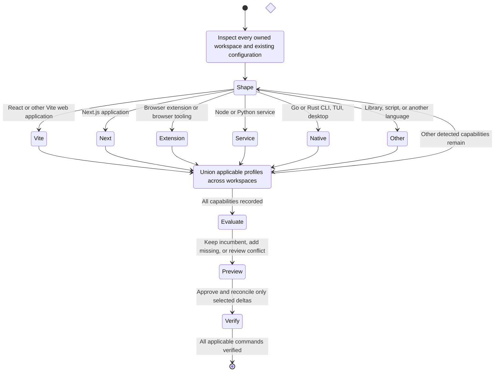
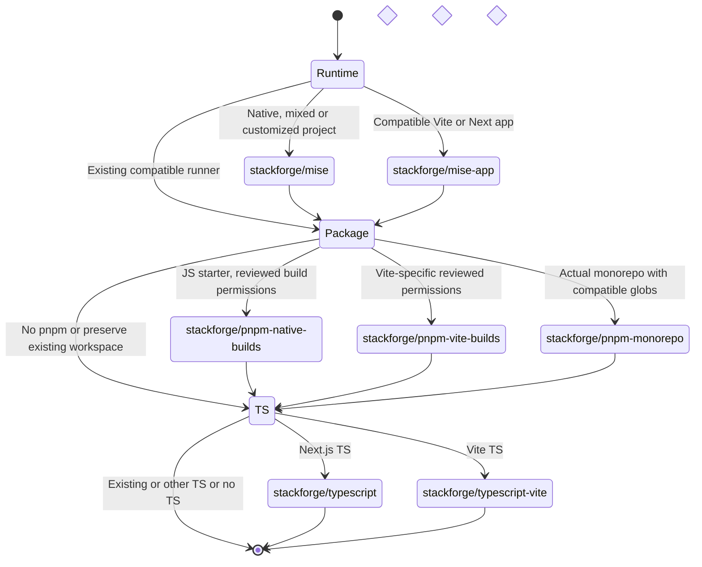
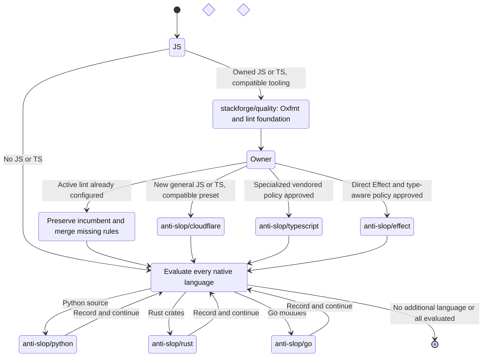
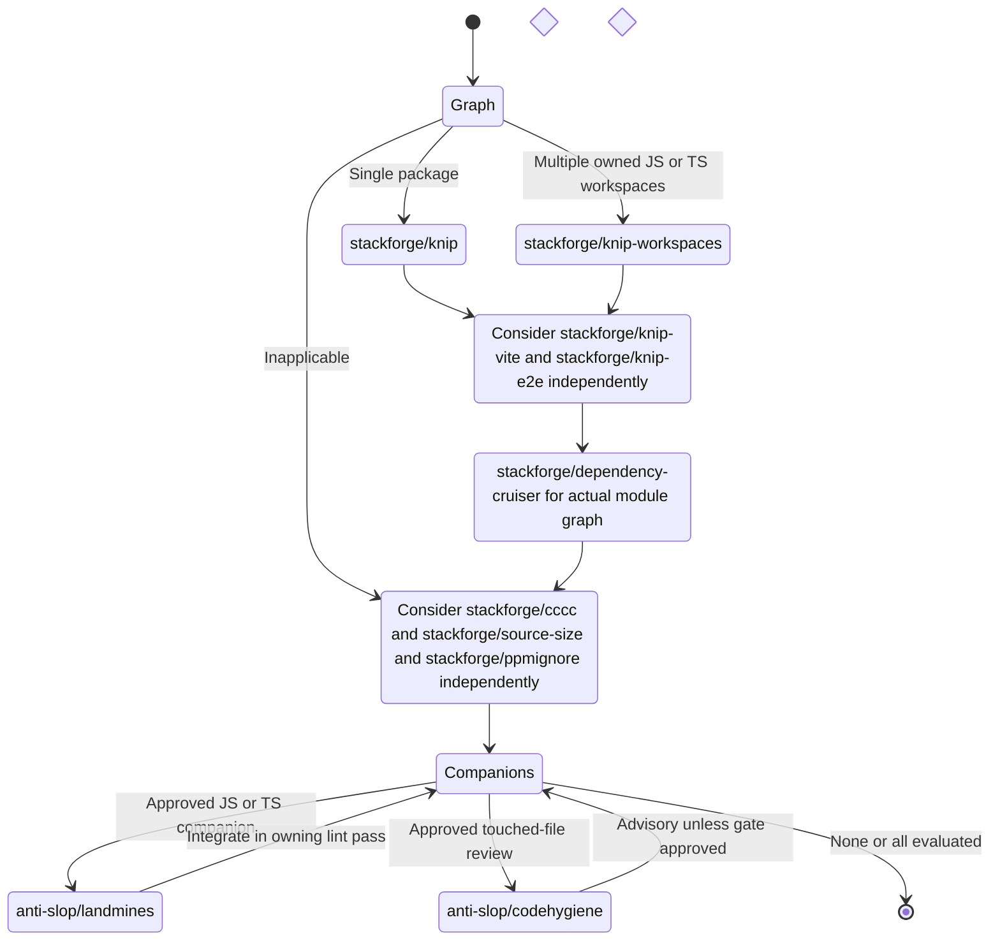
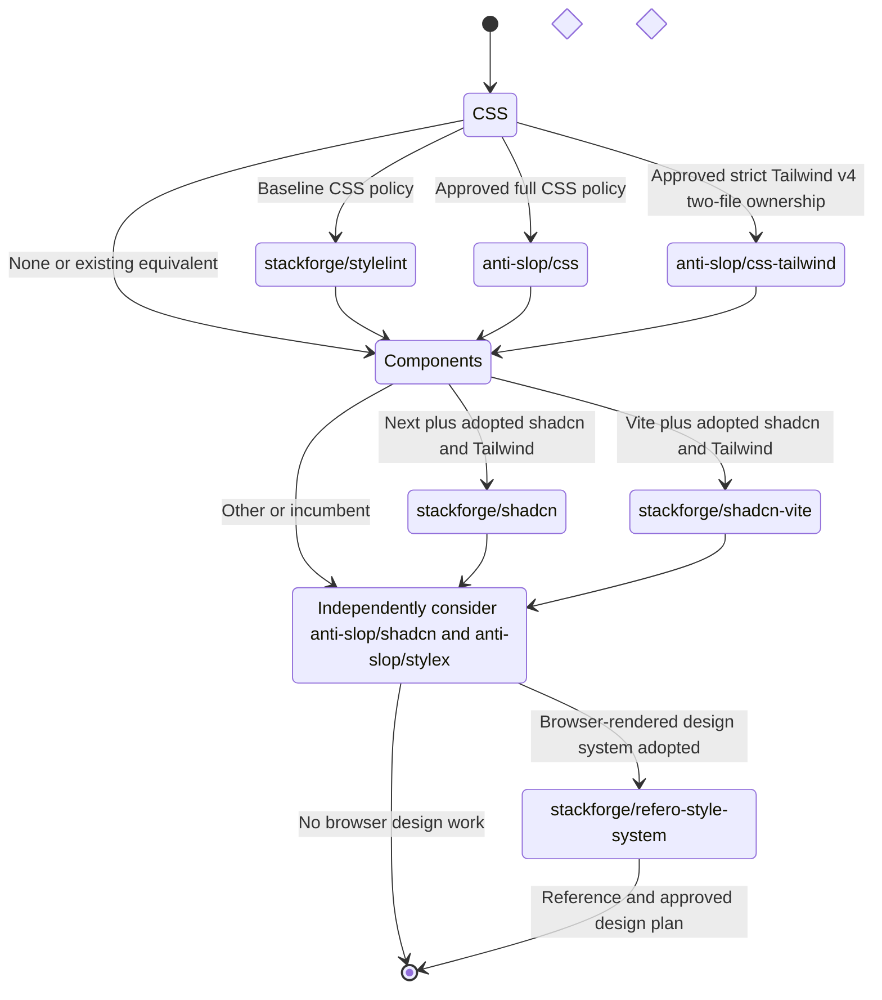
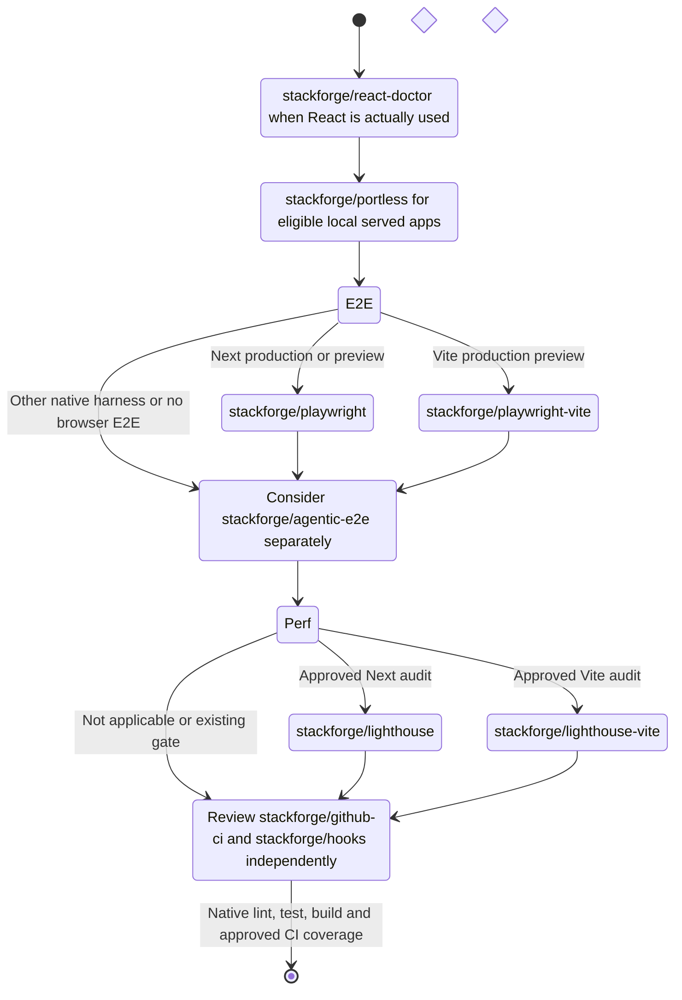
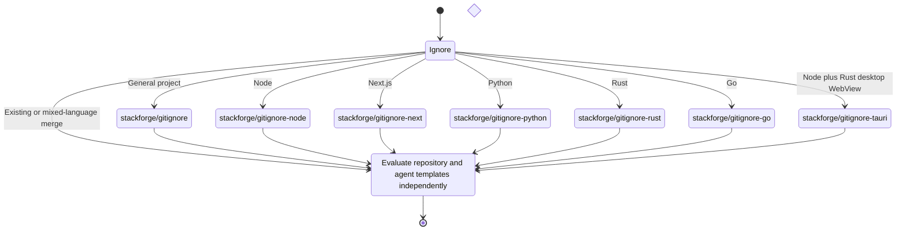
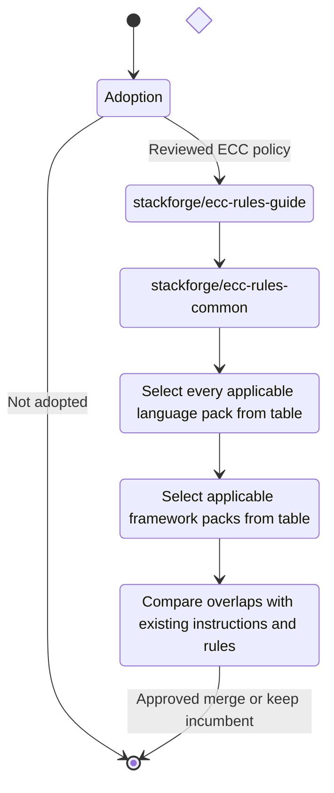
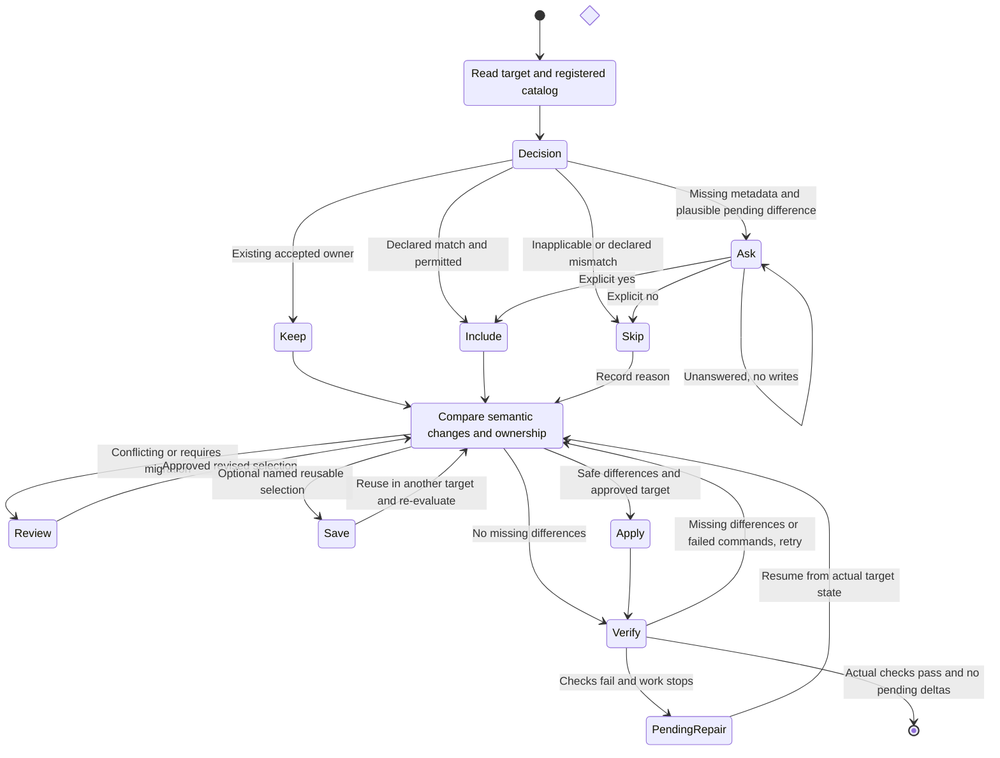

# Project setup selection: repository-derived decision atlas

This is the detailed decision variant of [all valid options](setup-selection-all-options.md). It makes the project patterns and every registered setup selectable rather than prescribing one universal bundle. Inventory: **67 Stackforge + 12 anti-slop = 79** (source manifests and installed catalog inspected). The profiles below are proposed reusable selections, not newly installed packs. Stackforge owns reusable assets; each target project owns its actual configuration. PPM engineering owns native setup and activation decisions.

## 1. Select the project capabilities



The branches are **additive capabilities**, not exclusive project types. A browser extension can have a Next.js website, Go native host, or Vite UI. A Python backend does not disable the JS/TS frontend's checks. Evaluate root-level owners once, then apply workspace-specific decisions at the owning scope. Do not treat a lockfile's transitive dependency, a checked-in fixture, a vendored copy, or a template example as owned application source.

### Observed configurations

These examples are based on tracked files and direct manifests inspected in the local repositories, not on inferred universal policy. Dependency or configuration presence is evidence of a candidate; it is not proof that a command is active.

| Pattern | Evidence from projects | Proposed reusable preference |
| --- | --- | --- |
| React/Vite workspace | ABPT: apps/web/vite.config.ts, pnpm-workspace.yaml, knip.json, .dependency-cruiser.cjs, stylelint.config.mjs, Playwright, React Grab, React Doctor. Registry Atlas: vite.config.ts, knip.jsonc, stylelint.config.mjs, cccc.toml, React Grab and Doctor. | JS quality + workspace analysis + React checks + CSS ownership + browser verification when applicable. |
| Next.js | Venice AI: next.config.ts, components.json, React Doctor, React Grab, dependency-cruiser, CCCC. 7ovr Landing Starter: .oxfmtrc.json, .oxlintrc.json, components.json, Playwright, Lighthouse, portless.json. | JS quality + Next variants, Tailwind/shadcn where adopted, browser checks, Portless when hosting locally. |
| Browser extension | PromptSnippets: Vite, React, native Go host, source-size.toml, existing Oxlint and ESLint, CI. Chat Exporter: React/Vite, Vitest, mise.toml, lefthook.yml. | Extension-aware build and test commands; no web-server presets unless a separate served app exists. Add Go checks for native host. |
| TypeScript + Python | Personal AI Bookmarks: pyproject.toml, frontend/vite.config.ts, knip.json, .ppmignore, CSS lint, CCCC. JEV Local Bridge: pyproject.toml, Vite, StyleX and Tailwind dependencies, explicit design-system lint, mixed-language CCCC. | JS/TS and Python in parallel; choose CSS and StyleX independently from actual source ownership. |
| Go + Python + shell | PPM: go.mod, ruff.toml, .pylintrc, cccc.toml, source-size.toml, .ppmignore, mise tasks for Go/Python/shell lint and security. | Native language checks + quality budgets + task orchestration; do not install Node tooling solely because of scripts or generated assets. |
| Rust CLI/TUI | Stackforge: Cargo workspace, mise.toml, lefthook.yml, CI and TUI smoke task. Cursor Session: Cargo.toml and mise.toml. | Cargo fmt/Clippy/test/build, Rust rules as selected, terminal interaction tests when present. |
| Python package | DSPyTeach: pyproject.toml and separate publish/release workflows. | uv/Ruff/Pylint as applicable, package tests/build, retain existing release pipeline. |
| UI laboratory | UI Pattern Laboratory: Vite, Storybook, Tailwind, shadcn, Vitest, E2E scripts. | Component-specific tests and interaction verification; no assumption that generic app CI is sufficient. |
| Starters | 7ovr Vite Starter and 7ovr Landing Starter: framework-specific TS, shadcn, Oxfmt/Oxlint, Git metadata, hooks, CI. | Offer complete starter assets only for new repositories or explicit migration, not as blanket replacements. |

**Observed deviations from a single default:** ABPT, Registry Atlas, Personal AI Bookmarks, JEV Local Bridge, PromptSnippets, and Venice AI use an existing `oxlint.config.ts` with vendored anti-slop rules. The newer Cloudflare default must not remove those rules or overwrite the incumbent config. CCCC thresholds differ: Registry Atlas 10/8; ABPT, Personal AI Bookmarks and JEV Local Bridge 15/10; PPM 12/10 (cognitive/cyclomatic). Keep accepted project budgets, and present any proposed tightening explicitly. The Stackforge quality template supplies JSON Oxlint config, while these projects own TypeScript config; merge the missing formatter/quality requirements into the existing owner rather than install a competing config. Pnpm pins also differ; use the target's compatible pinned versions.

### Suggested opinionated pack layers

These are **proposed** pack names and candidates for review, not persisted packs or a universal install list. Each row extends the compatible foundation; resolve the conditional alternatives to one actual setup ID before saving. Keep the source-qualified identity and the evidence for any exclusions.

| Layer / pack idea | Candidate selection to curate |
| --- | --- |
| JS/TS quality foundation | `stackforge/quality`, `stackforge/dependency-cruiser`, one of `stackforge/knip` or `stackforge/knip-workspaces`, `stackforge/cccc`, `stackforge/source-size`, `stackforge/ppmignore`; one reviewed JS lint strategy from section 3. |
| React/Vite application | Foundation + `stackforge/typescript-vite`, `stackforge/knip-vite`, `stackforge/react-doctor`; add `stackforge/shadcn-vite`, a CSS owner, `anti-slop/shadcn`, `stackforge/refero-style-system` only with matching UI ownership. |
| Next.js application | Foundation + `stackforge/typescript`, `stackforge/react-doctor`; matching `stackforge/shadcn`, CSS owner and Refero when applicable. |
| Browser verification | Framework-matched Playwright and Lighthouse variants; `stackforge/agentic-e2e` and `stackforge/knip-e2e` where that workflow is used. React Grab is a separate native dev integration. |
| Local app runtime | One of `stackforge/mise` or `stackforge/mise-app`; reviewed pnpm workspace policy; `stackforge/portless` only for eligible local servers. |
| Browser extension | JS/TS foundation + React Doctor when React is used; extension-native build/test harness and optional Go host layer; no Next/Vite served-app defaults merely because the extension uses Vite. |
| Python service/package | `anti-slop/python`, native uv/Ruff/test/build, and applicable `stackforge/mise`, `stackforge/cccc`, `stackforge/source-size`, `stackforge/ppmignore`; choose Python gitignore for new eligible repos. |
| Go CLI/TUI | `anti-slop/go`, native Go lint/test/build, applicable mise and complexity/size checks, Go gitignore for new eligible repos. |
| Rust CLI/TUI/desktop | `anti-slop/rust`, Cargo lint/test/build, applicable mise and complexity/size checks, Rust or Tauri gitignore as appropriate. |
| StyleX application | Add `anti-slop/stylex` only when actual StyleX ownership is verified; preserve other CSS policies on their separate scopes. |
| Repository hygiene | Reviewed Git metadata, contribution/agent files, one primary gitignore, skill locks, hooks, CI; ECC common plus relevant language/framework packs only where adopted. |
| Optional deeper review | `anti-slop/landmines` and/or `anti-slop/codehygiene` after separate compatibility and policy approval. |

The layer boundaries are deliberate: a monorepo can have a single root quality pack, a Vite web layer and Python or Go backend layers. Do not save incompatible whole-file alternatives together or assume a pack can express project-local merge decisions. The catalog's current metadata may offer less than the full applicable profile; use the explicit review path for missing options.

## 2. Runtime, workspace and TypeScript foundations



For JS/TS, prefer Bun runtime where compatible, pnpm dependency management, and mise for pinned tools; do not migrate package managers or runtimes without approval. For Python, use uv; for Rust and Go, use native Cargo/Go commands. Merge one `mise.toml` and one `pnpm-workspace.yaml` at each owning root, preserving actual workspace globs and only reviewed dependency build permissions. TS alias choices must agree across compiler, bundler, runtime, tests and lint; application default `@/*` to `./src/*`, same-directory relative imports, no parent traversal where the project policy applies. Preserve package exports in library/monorepo boundaries.

## 3. JS/TS lint, formatter and language-native rules



- `stackforge/quality` is a **coupled** Oxfmt/Oxlint template; it is not a safe second lint config. Preview the overlap, merge needed Oxfmt/settings into the active owner, and retain the existing diagnostics unless equivalent coverage is verified. JS-only evidence may justify offering quality even though its current automatic metadata requires TypeScript.
- Cloudflare is the current default for new compatible JS/TS projects. Keep existing vendored rules for incumbent projects; an Effect branch replaces the core owner only with compatibility and policy approval. Direct Effect can instead add reviewed supported rules to the incumbent.
- Native Python: uv, Ruff, Pylint, pytest/package build as applicable. Native Rust: cargo fmt, Clippy/rustc, Cargo test/build. Native Go: gofmt, go vet, anti-slop analyzer, Staticcheck, optional govulncheck, module tests/build. Owned shell: shfmt and ShellCheck. Native checks are additive and not independent catalog setups unless named above.

## 4. Code graph, complexity, structure and optional companions



Knip Vite and E2E extensions are additive only where their parser exception or E2E entrypoints are relevant. A pnpm-workspace file alone does not prove multiple analyzed workspaces; inspect the graph and preserve Knip's existing entry and ignore settings. The workspace Knip template only supplies a config; ensure its dependency, analyzer script and activation exist. Dependency Cruiser, import-path policy, CCCC, source-size and .ppmignore each have separate responsibilities. Do not hide owned files from analysis just to pass checks. Review Landmines rule overlap, and keep CodeHygiene advisory unless an explicit gate is approved. Existing RepoWise configuration/index is a separate native capability; verify its availability, never initialize or refresh without the governing project policy.

## 5. Frontend, CSS and component ownership



Use one Stylelint owner; merge approved rule deltas into it. Tailwind v4 does not imply strict two-file CSS ownership without a project design decision. StyleX lint requires actual StyleX source, official ESLint integration, and verified token/component paths. Both StyleX and shadcn lint may coexist on distinct source scopes, with no duplicate owner. Refero is an agent/design workflow, not an automatic framework migration; require an approved reference, DESIGN.md, tokens, one global stylesheet and consolidation plan. Existing UI registries, components and native TUI design contracts remain in their owning architecture. Select React Doctor for React source and official React Grab only for a supported browser React entrypoint; Grab is development-time inspection, not a lint gate.

## 6. Runtime hosting, browser verification and CI



Portless is for named local serving/proxy lifecycle, not for an extension or CLI without a server. Playwright and agentic E2E can coexist; use the appropriate Next/Vite base and local-model-only/BYOK agents where requested. Match browser test and build targets, inspect actual rendered behavior, and use native TUI PTY tests for terminal apps. For component laboratories, consider Storybook and component tests as native capabilities. Lighthouse is a distinct approved performance/accessibility gate. CI and hooks must preserve existing dispatch: local targeted checks, relevant pre-push, exhaustive supported offline PR/default-branch CI, required checks where permitted. Prefer Linux and existing Zoomies + official runners where eligible; exact routing, trust/isolation, permissions and project-specific approvals remain prerequisites. No global hook changes.

## 7. Repository files, skills and instructions



| Setup family | Decision and exact options |
| --- | --- |
| Git metadata | `stackforge/git-attributes`: LF normalization when appropriate; preview any large normalization change separately. |
| Contribution guide | `stackforge/contributing`: adapt to repository-native commands and owners. |
| Agent entrypoints | `stackforge/agent-instructions`, `stackforge/claude-instructions`: individually review; the CLAUDE starter is Next-specific. Do not replace existing AGENTS.md or instructions wholesale. |
| Skill dependency records | `stackforge/skill-lock`: only with actual installed skills and compatible lock format. |
| Starter GitHub directory | `stackforge/github`: new/approved starter repo only. Overlaps `stackforge/github-ci`; keep one workflow owner, preserve existing release/security/workflow files. |
| Agent skill directories | `stackforge/agents`, `stackforge/claude`: review individual settings and skills; both reference common canonical skill files, do not duplicate content or overwrite user-specific hooks/settings. |

For mixed languages, reconcile one .gitignore with necessary entries from relevant presets; do not apply several whole-file templates in sequence. Consider project-native verification and formal-verification skills, architecture docs, statecharts, and human-review notes as workflow capabilities outside the catalog. Do not add generated/design files contrary to repository policy.

## 8. ECC language and framework rules



Every ECC pack is an independent extension of common. These are instruction/rule assets, not evidence that a language-native lint command is installed.

| Evidence | Exact setup |
| --- | --- |
| Angular | `stackforge/ecc-rules-angular` |
| ArkTS | `stackforge/ecc-rules-arkts` |
| C++ | `stackforge/ecc-rules-cpp` |
| C# | `stackforge/ecc-rules-csharp` |
| Dart | `stackforge/ecc-rules-dart` |
| F# | `stackforge/ecc-rules-fsharp` |
| Go | `stackforge/ecc-rules-golang` |
| Java | `stackforge/ecc-rules-java` |
| Kotlin | `stackforge/ecc-rules-kotlin` |
| Nuxt | `stackforge/ecc-rules-nuxt` |
| Perl | `stackforge/ecc-rules-perl` |
| PHP | `stackforge/ecc-rules-php` |
| Python | `stackforge/ecc-rules-python` |
| React | `stackforge/ecc-rules-react` |
| React Native | `stackforge/ecc-rules-react-native` |
| Ruby | `stackforge/ecc-rules-ruby` |
| Rust | `stackforge/ecc-rules-rust` |
| Swift | `stackforge/ecc-rules-swift` |
| TypeScript | `stackforge/ecc-rules-typescript` |
| Vue | `stackforge/ecc-rules-vue` |
| Web application | `stackforge/ecc-rules-web` |

A direct framework can justify multiple packs (e.g. TypeScript + React + Web); do not assume all 21 packs apply merely because the common pack is present.

## 9. Curate, save, and reuse a selection



The profile is a curated preference, not an installation guarantee. A pack stores source-qualified IDs, not copied config or a blanket permission to apply. On reuse, review the destination and re-evaluate applicability, conflicts, existing ownership and activation. Incompatible packs need a revised selection, not forceful replacement.

```bash
# Discover current matches and uncertain options (with exact help commands).
stackforge --json setup recommend --target /path/to/project
stackforge setup update --recommended --target /path/to/project --dry-run

# Include reviewed uncertain candidates; preview before applying.
stackforge setup update --recommended --include-possible stackforge/stylelint --skip-possible --target /path/to/project --dry-run

# Save the exact reviewed IDs once, then preview in another target.
stackforge setup pack save NAME SOURCE/SETUP SOURCE/OTHER-SETUP
stackforge setup pack list
stackforge setup pack show NAME
stackforge setup update --pack NAME --target /path/to/another-project --dry-run

# Preview previously recorded installations independently.
stackforge setup update --all --target /path/to/project --dry-run
```

Use current TUI help for equivalent target selection, recommendations, candidate review, packs, and batch preview. A yes/no selection is separate from approval of conflicts or writes. A pending change with no recommendation metadata must be offered for a decision, not ignored; explicit mismatch is not an automatic suggestion. Already-equivalent applicable setups still need active command verification. If checks fail after applying changes, record the written changes and pending repair; do not represent the outcome as skipped, rolled back, or complete. Reconcile native tools with their owners, not a second installer. See [the detailed reconciliation flow](setup-selection-all-options.md#7-reconcile-missing-differences-before-finishing).

## Evidence and limits

Audit covered ABPT, ABOPS, Registry Atlas, PPM, PromptSnippets, Personal AI Bookmarks, Venice AI, Chat Exporter Extension, GH Repo Manager, Stackforge, Dirty Data, DSPyTeach, JEV Local Bridge, UI Pattern Laboratory, both 7ovr starters, anti-slop, Webcmd, Cursor Session, and Agent Workflow Runtime. Source snapshots: anti-slop `db4f7a4`, Stackforge `41e53b5`; installed source list returned 67 + 12 entries. Repositories were inspected read-only; no pack was created, no setup installed, no project migrated, and no CI configuration changed. These are proposed decision preferences grounded in the sampled projects, not approval to standardize their differences. Catalog definitions, active project policies and native commands take precedence over this document if they change.


### Verification evidence

The installed catalog, both canonical source manifests, and the qualified IDs in this atlas were compared as sets: **79 = 79 = 79**, with no missing or extra IDs. All 15 Mermaid diagrams in the three setup-selection documents render with Pele.

The bounded [TLA+ lifecycle model](verification/setup-selection/SetupReview.tla) and [generated statechart](verification/setup-selection/lifecycle.mmd) cover one abstract candidate, applicability evidence, approval, preview, conflict review, verification failure, pending repair, and reuse. TLC explored 60 states and 240 transitions; all six modeled safety/deadlock checks held. This verifies the abstract lifecycle, not the applicability of every setup or the runtime implementation of Stackforge. The view hides 28 transitions within the same displayed state.

To reproduce the lifecycle check, copy the TLA+, cfg and view files from `docs/verification/setup-selection/` into a temporary directory, then run from that directory:

```bash
"$HOME/tools/plugins/pstack/skills/statechart/scripts/statechart" SetupReview.tla --config SetupReview.cfg --view view.ts --out model-check
```

The model deliberately abstracts project-specific manifests, filesystem operations, multi-candidate interactions, and actual check execution. Consult the real preview and run the affected checks before applying any setup.
