# Project setup selection statechart

Use this chart to choose **additional** anti-slop and Stackforge setups for each detected workspace. The setup names come from [`stackforge.setups.toml`](../stackforge.setups.toml). The manifest and each install guide remain the authority for files, versions, and activation commands.

```mermaid
stateDiagram-v2
    direction TB

    [*] --> Inspect
    state "Inspect manifests, source, existing tools" as Inspect
    state "Choose one JS/TS lint strategy" as Core <<choice>>
    Inspect --> Core: Workspace evidence collected

    state "Keep and adapt incumbent lint" as Existing
    state "cloudflare" as Cloudflare
    state "typescript" as TypeScript
    state "effect" as Effect
    state "No JS/TS lint setup" as NoJS
    Core --> Existing: Existing configured lint pass
    Core --> Cloudflare: Fresh general JS/TS + compatible runtime
    Core --> TypeScript: Specialized rules approved
    Core --> Effect: Direct Effect + type-aware policy approved
    Core --> NoJS: No JS/TS source

    state "Add native language setups" as Native
    Existing --> Native
    Cloudflare --> Native
    TypeScript --> Native
    Effect --> Native
    NoJS --> Native

    state "Choose authored-CSS lint" as CSS <<choice>>
    Native --> CSS: Add python, rust, go when present
    state "css-tailwind" as StrictCSS
    state "css" as GeneralCSS
    state "No CSS lint setup" as NoCSS
    CSS --> StrictCSS: Tailwind v4 + strict two-file contract approved
    CSS --> GeneralCSS: Authored CSS + other ownership
    CSS --> NoCSS: No authored CSS

    state "Add eligible UI lint" as UI
    StrictCSS --> UI
    GeneralCSS --> UI
    NoCSS --> UI
    state "Consider optional companions" as Optional
    UI --> Optional: shadcn for Tailwind v4 UI; stylex when used
    state "Preview planned setups" as Preview
    Optional --> Preview: Landmines and CodeHygiene only by opt-in

    state "Review conflicts or missing approval" as Review
    state "Apply to target project" as Apply
    state "Verify actual installed checks" as Verify
    Preview --> Review: Conflict, incompatible versions, or no approval
    Review --> Inspect: Revise selection; preserve incumbents
    Preview --> Apply: Dry-run reviewed and approved
    Apply --> Review: Activation or verification failed
    Apply --> Verify: All selected checks passed
    Verify --> [*]
```

## Guard decisions

| Evidence in the target workspace | Setup selection |
| --- | --- |
| Existing lint or vendored anti-slop configuration | Preserve and update or merge into the **existing pass**. Migration to another core strategy is a separate approved change. |
| Fresh JS/TS application, compatible with the published preset | Prefer `cloudflare` for general lint. This is the default candidate, **not** an extra pass over `typescript`. |
| JS/TS source needs anti-slop rules beyond Cloudflare | Choose `typescript` instead, after reviewing the specific rules and accepting vendored ownership. |
| Direct `effect` dependency and approved official type-aware diagnostics | Choose `effect` **instead of** `typescript`. The setup combines generic anti-slop, Effect architecture rules, and `@effect/tsgo` in one pass. |
| Effect used without the integrated type-aware opt-in | Keep the chosen JS/TS lint pass. Add the supported custom Effect rules to it only when their applicability and compatibility are reviewed. A transitive lockfile entry alone is insufficient. |
| Python packages, Rust crates, or Go modules | Add `python`, `rust`, and `go` independently for each detected language. Retain Ruff, Cargo formatting and Clippy, and `go vet` as applicable. |
| Authored CSS with a project-specific or non-Tailwind stylesheet architecture | Choose `css`. |
| Tailwind v4 with an explicitly accepted `globals.css` and `tokens.css`-only architecture | Choose `css-tailwind` **instead of** `css`; do not impose its file restrictions on other projects. |
| Tailwind v4 UI whose design-system rules were reviewed | Add `shadcn`. It is independent of the CSS Stylelint choice. |
| Actively used StyleX | Add `stylex` after configuring actual token and component import paths. Vue/Svelte templates need the relevant ESLint parsers; avoid duplicate file coverage. |
| JS/TS project explicitly requests the upstream testing/structure companion | Consider `landmines` after checking runtime compatibility, overlapping rules, and comment policy. |
| Project explicitly requests a touched-file readability review | Consider `codehygiene`. Keep it advisory until the project separately approves `--check` as a gate. |

## Activation rules

1. Inspect **each** package or module in mixed-language monorepos, including nested workspaces. A project may require several additive setups.
2. Keep exactly one owning JS/TS core lint pass and at most one CSS architecture preset per workspace. Other applicable setups can coexist without duplicate lint execution.
3. Preview with `stackforge setup apply anti-slop/<setup> --target <project> --dry-run`. Use the setup's own guide to resolve provenance, installed versions, config ownership, and compatibility.
4. Require approval for replacing an existing config, enabling opinionated architecture rules, imposing strict stylesheet ownership, or changing an advisory tool into CI enforcement.
5. Apply only reviewed setups. Run their actual activation checks and the project's existing targeted lint, test, and build commands. Treat a staged file or passing configuration parse as **not yet verified**.
6. Do not trigger framework migrations, style conversions, global hook changes, or runner/CI rewrites as side effects of this selection.

This chart is a **selection and review contract**, not an automated detector. The installed Stackforge/PPM bootstrap owns execution and its compatibility checks. In projects with custom setup ownership, prefer the existing native tooling over a second copy.
